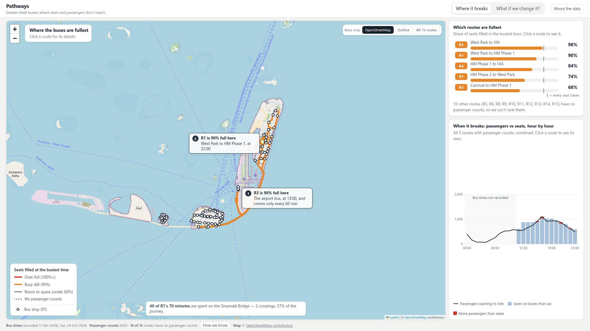
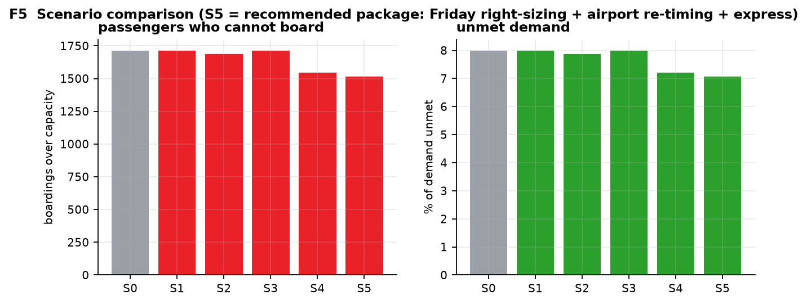

# Pathways

**An interactive tool for matching bus supply to passenger demand in Greater Malé.**
Maldives Datathon 2026 · Team Wayfinders

> **Move a bus. See who is left behind.**
> Fifteen routes, one Saturday of real service, and a scenario bar that re-times
> existing trips — no new vehicles — and shows what happens to the people
> waiting.

```bash
make serve          # builds the dashboard and serves it on :4444
# open http://localhost:4444

# or, for live reload while editing:
cd web && npm install && npm run dev      # http://localhost:5173
```

Needs Node 20+ for the first build (`make web`); after that the app is a static
bundle that reads the committed CSV files. No backend, no account. The base map
is OpenStreetMap raster tiles, so it is the one thing that wants a network — if
the tile host is unreachable the map falls back on its own to the outline
committed in `dashboard/data/basemap.geojson`, and every route still draws.
Tiles and the data tables are cached by a small service worker (`web/public/sw.js`),
so zooming back over ground you have already covered costs no requests.

---

## The tool



| Panel | What it shows | What it is for |
|---|---|---|
| **Map** | All 15 routes as polylines on OpenStreetMap (Malé, airport island, Hulhumalé, Villimalé), coloured by how full each one runs, with all 97 bus stops marked | Find the corridors in trouble without reading a table, and see where a passenger can actually board |
| **Route panel** | Demand against seats hour by hour, the timetable ribbon, and where along the route the bus fills | See *when* and *where* the mismatch is, not just that it exists |
| **Scenario bar** | Five fleet-neutral packages, every KPI shown with its delta against baseline | Move trips and read the consequence immediately |
| **Method drawer** | Coverage matrix, capture window, source per table, the working-hours assumption | Audit any number without leaving the page |

The interface enforces two rules, because the data does:

- **Uncaptured is not empty.** Service was captured from about 11:00 onwards, so
  earlier hours are drawn as a gap — never as zero. A chart showing no morning
  buses would be a lie about Malé.
- **Unknown is not zero.** Ten of the 15 routes have no ridership data at all.
  They are marked unknown rather than drawn at 0%.

## How this meets the challenge

The datathon asks for an interactive, GIS-powered statistical dashboard that
uses open data to support transport decisions. This is how the submitted tool
answers that brief:

- **GIS across the region.** Four islands — Malé, Hulhulé, Hulhumalé and
  Villimalé — 15 routes and 97 stops, drawn on OpenStreetMap road geometry.
- **Open data filling a gap.** 321 schools, offices, hospitals, mosques, markets
  and shops scraped from OSM and classified by demand curve, then matched to the
  nearest stop. Only 3 are more than 400 m from service; the blind spot is
  documented, not hidden.
- **Movement patterns, measured and modelled.** 371,788 taxi trips supply the
  hourly shape; MTCC counts supply the level. The split is labelled on screen.
- **An intervention, not just a chart.** Five fleet-neutral scenarios re-time
  existing trips. S5 removes 404 over-capacity boardings by moving six trips.
- **A reusable output.** A GTFS feed any journey planner can read, and a build
  that re-derives all 92 claims from the raw sources.

## What the tool shows you

| # | On screen | The finding |
|---|---|---|
| **1** | Two segments on R1 and R2 drawn thicker and red | **The Sinamalé Bridge is the journey.** R1 is scheduled at 70 minutes; **forty of those minutes — 57% — are two crossings of the bridge.** A taxi does the same trip in a median of 12.7 minutes. The bus is **5.5 times slower and 8.5 times cheaper**. People are not buying speed; they are paying to avoid an hour in a queue. |
| **2** | R3's line red at the airport end, its timetable ribbon one tick per hour | **The airport bus is full, and it runs once an hour.** R3 looks lightly used over a whole day — 68% of its seats — but on the final segment into the airport it reaches **98% of capacity**, and the bus comes once an hour: a 30-minute expected wait. The average hid the crush. |
| **3** | The load-factor band on R1's panel | **The busiest corridor is near capacity, not over it.** R1 carries 4,585 passengers a day against 4,392 seats. That ratio — 104% — assumes every passenger rides end to end, which nobody does. At its busiest segment R1 is **90% full**, and **82%** at its busiest demand hour. It degrades late in the evening, when service thins. |
| **4** | The period bar in the drawer, working hours highlighted | **Most bus use happens outside the working day.** On an assumed 08:00–16:00 day, **39% of bus travel falls inside it**. The three-hour evening commute alone carries 21% — more than half the working day's share. |
| **5** | The taxi-capture tile, two probabilities side by side | **A cheaper bus will not win riders.** On fare alone, 62–76% of taxi passengers would switch. Once travel time is counted, 0.05–9.3% would. The bus would need to save 54 minutes on the Malé–Hulhumalé corridor. No discount closes that gap. |

## The scenario bar, in practice

Pick **S5 — recommended package**. Six trips move out of the airport routes'
afternoon lull and into R1 where the queues are. Nothing else changes: no new
buses, no extra drivers, the same 162 trips on the evaluated routes.

| | Baseline | S5 |
|---|---|---|
| Boardings over capacity | 1,009 | **605** |
| Unmet demand | 10.0% | **6.0%** |
| Mean wait | 10.8 min | 10.7 min |
| Trips moved | — | **6** |
| New vehicles | — | **0** |

**404 fewer boardings are over capacity — 1,009 down to 605 — by moving 6
existing trips.**

The other four scenarios are there to be tried, including the ones that fail:
re-timing airport buses on their own relieves only 2 boardings, and the
"express peak" scenario finds exactly one safe move, because the corridor has
almost no spare capacity to donate. A donor may only give up a trip if it stays
within 100% of seats afterwards ([ADR-0014](docs/adr/0014-donor-ceiling.md)).
The tool shows the null results rather than hiding them.



## What the tool cannot show

| Limit | Why | How the tool handles it |
|---|---|---|
| The morning peak | The timetable feed returns only the rest of the day from the moment it is called; our capture is ~11:00–24:00 | Drawn as an explicit gap, with a bounded route-day estimate in `morning_service_inferred.csv` |
| 10 of 15 routes | MTCC counts ridership on R1, R2, R3, R4, R7 only | Marked `NO DEMAND DATA`, never zero-filled |
| Airport totals | The airport extract covers ~40% of international arrivals, no domestic flights, no seasonal signal | Levels come from the national yearbook; the extract supplies only the hourly shape |
| Working hours | 08:00–16:00 is an assumption — no published data exists | Published as a band: 07:00–15:00 gives 37%, 09:00–17:00 gives 42% |
| The day itself | One Saturday in October 2026, not a weekday | Stated on screen |
| Where the bus is full | Load factors are allocated from taxi catchments, not counted on the bus | Labelled as modelled in every cell that carries one |

## Trust: verified, not asserted

- The demand model predicts held-out ridership with **9.9% mean absolute
  percentage error**, against **16.3%** for a naive baseline, on 219 held-out
  days it never saw.
- `make check` re-derives 92 claims from the raw sources and fails if the
  committed numbers disagree. It passes **92/92** — including checks that the
  prose in this README still matches the data.
- Every figure on screen traces to a committed CSV, and every CSV row carries
  its source.

## Build it yourself

```bash
make setup      # create .venv and install the pinned dependencies
make data       # rebuild every derived table from data/raw and data/official
make figures    # F1..F7 into docs/figures/
make gtfs       # rebuild the GTFS feed
make check      # re-derive 92 claims; exit code 0 = everything holds
make web        # build the dashboard (React app in web/) into web/dist
make all        # data + figures + gtfs + check + tests
```

A clean rebuild produces no diff — including the GTFS zip, whose members are
stored rather than deflated so the archive is bit-identical on any machine.

## The GTFS feed

We publish **a GTFS feed for the Greater Malé bus network** — the
standard format every journey planner already reads.

**We could not find a public GTFS for Malé**, so we built one from the official
RTL timetable. It describes the real 2026 schedule — and its stop times are the
observed schedule, not interpolated from an assumed bus speed.

| | |
|---|---|
| Routes | 11 (R1–R9, R13, R14) |
| Stops | 61 |
| Trips | 450 |
| Stop times | 5,538 |
| Validator errors | **0** (MobilityData `gtfs-validator` 6.0.0) |

It makes the network portable: OpenTripPlanner, MOTIS, Transitland, Google
Transit and most trip-planning apps can route on it with no bespoke code — and
GTFS is the format GTFS-Realtime extends, so it is the foundation for the live
phase in the roadmap. It is an honest snapshot, not a production feed: one
Saturday, 11 of 15 routes, no minibus timings.
**[docs/GTFS.md](docs/GTFS.md)**

## Data

Every figure traces to a public source. Nothing private or restricted was used.

| Data | Publisher | What it gave us |
|---|---|---|
| Bus timetable, stops, fares | RTL / MTCC | Official routes and departure times, current 2026 |
| Bus passenger counts | MTCC via MBS | Daily passengers on R1, R2, R3, R4, R7 |
| Taxi trips | Avas via MBS | 371,788 trips, August–September 2026 |
| Airport arrivals | MACL via MBS | Hourly international arrivals, 2012–2026 |
| Census 2022 | MBS | Population by locality — the scale of each catchment, used as context rather than a model input |
| Statistical Yearbook | MBS | Airport totals including domestic; labour force |
| Map data | OpenStreetMap contributors | Basemap, road network and trip generators (ODbL) |

Access by island, from the OpenStreetMap scrape (`data/derived/poi_access_gaps.csv`):

| Island | Mapped trip generators | More than 400 m from a stop |
|---|---|---|
| Malé | 239 | 0 |
| Hulhumalé | 65 | 1 |
| Hulhulé (airport) | 13 | 1 |
| Villimalé | 3 | 0 |
| Outside the mapped islands | 1 | 1 |
| **Total** | **321** | **3** |

The scrape records its own blind spot: north of Hulhumalé Phase 1, OSM holds
6 named POIs against roughly 2,900 mapped buildings. Absence of a POI means
unmapped, not vacant.

Full links, licences and caveats: **[DATA_SOURCES.md](DATA_SOURCES.md)**.

## Where this goes next

The tool is a projection built on history: it answers whether the buses matched
demand on the day we measured, not whether they match now.

- **Realtime.** People-counting at stops, vehicle positions over GTFS-Realtime,
  and a loop that reallocates trips as queues build. It closes the model's
  weakest point: stop-level loads are allocated from taxi catchments, not
  measured. Costs, sensor comparison, pilot design and preconditions:
  **[docs/ROADMAP.md](docs/ROADMAP.md)**.
- **Event-driven demand.** An event calendar keyed to venue, date and expected
  attendance, applying a short uplift before reallocation. GTFS already carries
  the output as `calendar_dates` exceptions; the hard part is calibration, which
  needs at least two observed events.
- **Routes from future demand.** The 321 OpenStreetMap trip generators are
  already classified by demand curve and matched to their nearest stop.
  Missing: population density by island and Malé ward, and opening dates for new
  commercial and office space. Output is a candidate corridor, not a timetable —
  and the fleet-neutral engine can show a route would fill but cannot fund the
  bus.

## For readers who want the detail

- **[docs/METHODS.md](docs/METHODS.md)** — data sources, methods, assumptions, AI use and limits
- **[docs/GTFS.md](docs/GTFS.md)** — the feed, its design decisions, and how to load it
- **[docs/ROADMAP.md](docs/ROADMAP.md)** — the path to realtime, two extensions beyond it, and the costs and preconditions
- **[docs/mockups/](docs/mockups/README.md)** — two design sketches: proposed new routes, and hour-by-hour re-timing
- **[SPEC.md](SPEC.md)** — what we built, how, and what we would do next
- **[RESEARCH.md](RESEARCH.md)** — the full investigation, including what we tried and rejected
- **[docs/adr/](docs/adr/)** — a record of each methodological decision and its cost
- **[docs/DASHBOARD_SPEC.md](docs/DASHBOARD_SPEC.md)** — the dashboard build contract
- **[docs/TEAM.md](docs/TEAM.md)** — ownership and how to verify any number

---

**Team Wayfinders** · Maldives Datathon 2026
